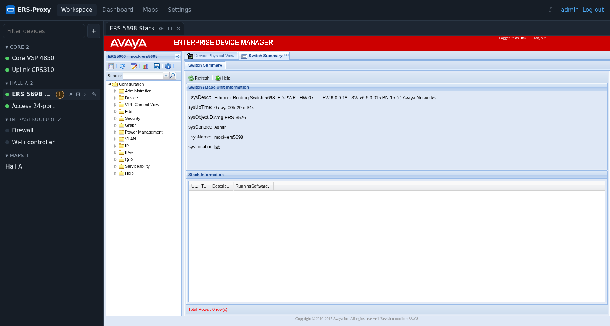
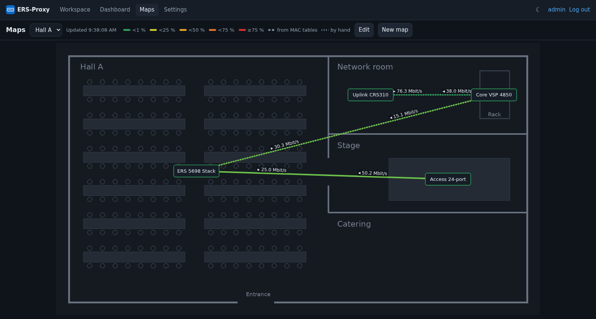
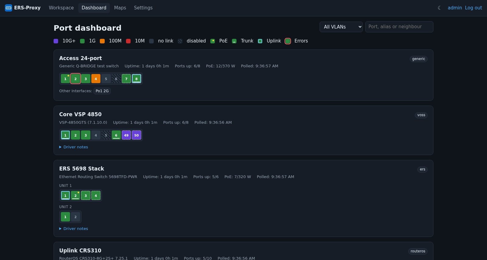
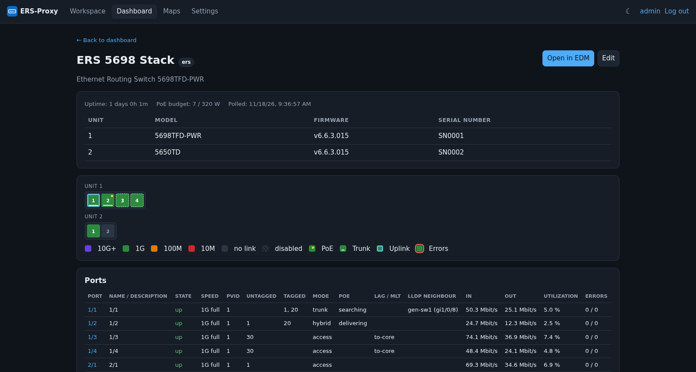
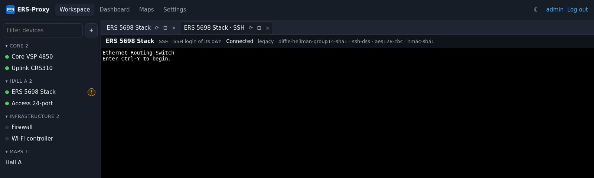

# ERS-Proxy

**One portal for the web interfaces of your switches – and a fix that makes the EDM of old
Avaya/Extreme ERS switches work in today's browsers.**

> What changed in each release: [CHANGELOG.md](CHANGELOG.md). What comes next:
> [docs/ROADMAP.md](docs/ROADMAP.md).



## What it does

### One portal for all switch web interfaces

- **Repairs EDM in modern browsers.** The Enterprise Device Manager built into ERS 5600 (and
  related ERS families) breaks in current Firefox, Chrome and Edge: Ext JS 2.2 reads response
  headers case-sensitively, modern browsers report them in lower case, and every request
  fails after the login. ERS-Proxy fetches EDM from the switch, fixes the affected files on
  the fly and serves them to your browser. Nothing is changed on the switch.
- **All devices in one place.** ERS and VSP switches and MikroTik SwOS switches open through
  the proxy (with automatic login), MikroTik RouterOS devices show WebFig through the proxy,
  and any other device (modern switches, firewalls, access points) is a direct link. Web
  interfaces open on the right in tabs, in a new browser tab or in a popup window; each user
  and each device can choose.
- **Add many devices quickly.** One by one, several at once (a table form – paste rows from a
  spreadsheet, shared settings such as type, group, monitoring and credentials apply to all) or
  imported from JSON/CSV.

### Network maps

Place your switches on a floor plan and see the links between them with their live rates and
utilisation. Links are found automatically from LLDP, else from the switches' MAC address
tables, and can be drawn by hand; automatic links can be hidden. Everyone can view maps, admins
edit them. Maps also open as tabs in the workspace. Details:
[docs/monitoring.md](docs/monitoring.md#network-maps).



### Port dashboard

Every port of every monitored switch at a glance: link, speed, duplex, VLANs, PoE, LAG, LLDP
neighbour and traffic with history – read-only via SNMP, via the EDM interface on ERS and VSP
switches, or via the web API of SwOS and the REST API of RouterOS. Vendors plug in as drivers
(generic Q-BRIDGE, ERS, VSP/VOSS, Cisco, TP-Link, MikroTik SwOS and RouterOS). See
[docs/monitoring.md](docs/monitoring.md).





### SSH console (optional)

Admins can open an SSH terminal for a device right in the workspace – also on old Avaya ERS
switches that only speak `ssh-dss` and SHA-1, through a separate legacy profile that is used
for nothing else. Host keys are confirmed by fingerprint before a login is sent. Off unless
enabled in `config.yaml`.



### Change settings (optional, experimental)

Off by default. With `configure.enabled` in `config.yaml`, admins can change port VLANs, port
state and name, VLANs and PoE from the dashboard – VSP/VOSS first. Every change is previewed,
applied "commit confirmed" and reverted automatically unless it is confirmed in time. See
[docs/switch-configuration.md](docs/switch-configuration.md).

### Safe by design and easy to run

- **Safe by design.** Switch content runs in a browser sandbox and cannot reach the portal or
  other switches; switch cookies never reach the browser; stored switch passwords are
  encrypted; HTTPS to the switch works with the old TLS versions these devices speak, with
  certificate pinning instead of blind trust. See [docs/security.md](docs/security.md).
- **Easy to run.** One static binary, SQLite, packages for Debian/Ubuntu, Fedora/RHEL, Arch and
  Alpine, and a Docker image. Works behind a reverse proxy on a single domain and port.

## Install

### From the lan.party package repository (recommended)

Set up the repository once, then install and update the package with your system's package manager.
Instructions for Debian/Ubuntu, Fedora/RHEL/Rocky, Arch Linux and Alpine: **https://repo.lan.party**

```sh
curl -fsSL https://repo.lan.party/setup.sh | sudo sh   # or follow the manual steps on repo.lan.party

sudo apt install ers-proxy      # Debian / Ubuntu
sudo dnf install ers-proxy      # Fedora / RHEL / Rocky
sudo pacman -S ers-proxy        # Arch Linux
sudo apk add ers-proxy          # Alpine
```

New releases then arrive with your normal system updates (`apt upgrade`, `dnf upgrade`, `pacman -Syu`, `apk upgrade`).

### Manual download from GitHub releases

Packages are attached to each [GitHub release](https://github.com/lan-dot-party/ERS-Proxy/releases):

```bash
curl -LO https://github.com/lan-dot-party/ERS-Proxy/releases/download/vX.Y.Z/ers-proxy_X.Y.Z_amd64.deb
sudo apt install ./ers-proxy_X.Y.Z_amd64.deb
sudo nano /etc/ers-proxy/config.yaml              # listen, public_url
sudo ers-proxy user create admin --role admin
sudo systemctl enable --now ers-proxy
```

### Docker Compose

Two ready-made examples in the repository root, both with the multi-arch image
`ghcr.io/lan-dot-party/ers-proxy`:

| File | Persistent data | When to use |
|---|---|---|
| [`compose.yaml`](compose.yaml) | named Docker volume `ers-proxy-data` | simplest; Docker manages the data |
| [`compose.bind.yaml`](compose.bind.yaml) | local directory `./data` | data visible on the host, easy to back up; the directory must belong to UID `100` / GID `101` (the container user) |

Before the first start, set `ERSPROXY_PUBLIC_URL` in the file to the address users open in the
browser. The port is published on `127.0.0.1:9050` for a reverse proxy on the same host.

With a named volume:

```bash
curl -fsSLO https://raw.githubusercontent.com/lan-dot-party/ERS-Proxy/main/compose.yaml
docker compose up -d
docker compose exec ers-proxy ers-proxy user create admin --role admin
```

With a local directory:

```bash
curl -fsSLO https://raw.githubusercontent.com/lan-dot-party/ERS-Proxy/main/compose.bind.yaml
mkdir -p data && sudo chown 100:101 data
docker compose -f compose.bind.yaml up -d
docker compose -f compose.bind.yaml exec ers-proxy ers-proxy user create admin --role admin
```

Update with `docker compose pull && docker compose up -d` (add `-f compose.bind.yaml` for the
second variant). Backup, reverse proxy and details:
[docs/installation.md](docs/installation.md#docker-compose).

Details, Docker and reverse proxy setup: [docs/installation.md](docs/installation.md),
[docs/reverse-proxy.md](docs/reverse-proxy.md), [docs/configuration.md](docs/configuration.md).

## Supported devices

See [docs/compatibility.md](docs/compatibility.md). Please report your model and firmware with
the "Device report" issue template – the diagnostics page shows what to paste.

## Documentation

| Document | Content |
|---|---|
| [docs/ROADMAP.md](docs/ROADMAP.md) | Phases, steps and current status |
| [docs/architecture.md](docs/architecture.md) | Packages, request flow, data model |
| [docs/security.md](docs/security.md) | Threat model, mitigations, residual risks |
| [docs/configuration.md](docs/configuration.md) | `config.yaml` reference |
| [docs/installation.md](docs/installation.md) | Packages, Docker, first steps |
| [docs/reverse-proxy.md](docs/reverse-proxy.md) | Nginx, Caddy, Apache |
| [docs/compatibility.md](docs/compatibility.md) | Verified switches and firmware |
| [docs/monitoring.md](docs/monitoring.md) | Port dashboard and network maps: enabling, testing, history, troubleshooting |
| [docs/drivers.md](docs/drivers.md) | Writing a port dashboard driver for another vendor |
| [docs/hardware-tests.md](docs/hardware-tests.md) | Checklist for verifying a switch model on real hardware |

## Development

```bash
go test ./...
CGO_ENABLED=0 go build -o bin/ers-proxy ./cmd/ers-proxy
./bin/ers-proxy -c config.yaml config init
echo 'a-long-password' | ./bin/ers-proxy -c config.yaml user create admin --role admin
./bin/ers-proxy -c config.yaml server          # http://127.0.0.1:9050
```

See [CONTRIBUTING.md](CONTRIBUTING.md).

## Related projects

ERS-Proxy is part of the lan-dot-party tool suite with
[LANLeecher](https://github.com/lan-dot-party/LANLeecher),
[LANPilot](https://github.com/lan-dot-party/LANPilot) and
[FlowGauge](https://github.com/lan-dot-party/FlowGauge).

## License

MIT, see [LICENSE](LICENSE). Avaya, Extreme Networks, ERS and EDM are trademarks of their
owners; this project is not affiliated with them and ships none of their files.
